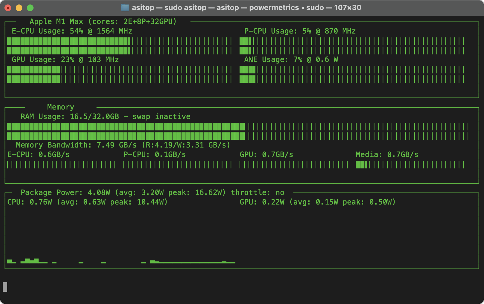

# asitop — Apple Silicon Performance Monitor (M5 Max Support)

Performance monitoring CLI tool for Apple Silicon Macs — **with Apple M5 support**.

This is a maintained fork of [tlkh/asitop](https://github.com/tlkh/asitop) that fixes the crash on Apple M5, M5 Pro, M5 Max, and M5 Ultra. The upstream repo has been inactive since January 2023 and does not support M5's unified cluster architecture.



## What Changed (M5 Fix)

Apple M5 chips use a **unified M-cluster architecture** instead of the separate E-Cluster/P-Cluster naming used by M1–M4. Upstream asitop crashes immediately on M5 with:

```
KeyError: 'E0-Cluster_active'
```

This fork fixes the crash by detecting M-prefixed clusters in the powermetrics output and mapping them correctly to the asitop dashboard. It also adds M5 Max TDP and memory bandwidth values.

**Upstream PR:** [tlkh/asitop#92](https://github.com/tlkh/asitop/pull/92)

## Installation

Install from this fork (recommended for M5 Macs):

```shell
pip install git+https://github.com/ProducerGuy/asitop.git
```

## Usage

```shell
# recommended — enter password before start
sudo asitop

# advanced options
sudo asitop [--interval INTERVAL] [--color COLOR] [--avg AVG]
```

| Flag | Description | Default |
|------|-------------|---------|
| `--interval` | Sampling interval in seconds | 1 |
| `--color` | Display color (0–8) | 2 |
| `--avg` | Averaging window in seconds | 30 |

## What It Shows

- **CPU utilization** — per-cluster frequency and active residency (P-CPU and E-CPU gauges)
- **GPU utilization** — frequency, active residency percentage
- **ANE utilization** — estimated from power draw
- **Memory** — RAM and swap usage
- **Power** — CPU, GPU, and package power draw with rolling average and peak tracking
- **Thermal** — throttle status

## Supported Hardware

| Chip | Status | Notes |
|------|--------|-------|
| Apple M1 / M1 Pro / M1 Max / M1 Ultra | Supported | Original upstream support |
| Apple M2 | Supported | Original upstream support |
| Apple M3 / M3 Pro / M3 Max / M3 Ultra | Supported | Uses default TDP values |
| Apple M4 / M4 Pro / M4 Max / M4 Ultra | Supported | Uses default TDP values |
| Apple M5 / M5 Pro / M5 Max / M5 Ultra | Supported | **Fixed in this fork** — M-cluster architecture |

## How It Works

`asitop` reads hardware performance counters via macOS's built-in [`powermetrics`](https://www.unix.com/man-page/osx/1/powermetrics/) utility (requires `sudo`). It also uses [`psutil`](https://github.com/giampaolo/psutil) for memory/swap and `sysctl`/`system_profiler` for CPU and GPU core counts.

Some values (TDP, max bandwidth, ANE max power) are hardcoded estimates per chip model.

## License

MIT — see [LICENSE](LICENSE).

## Credits

Original project by [Timothy Liu](https://github.com/tlkh). M5 support added by [ProducerGuy](https://github.com/ProducerGuy).
